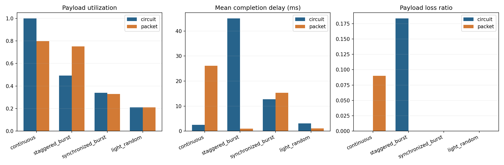
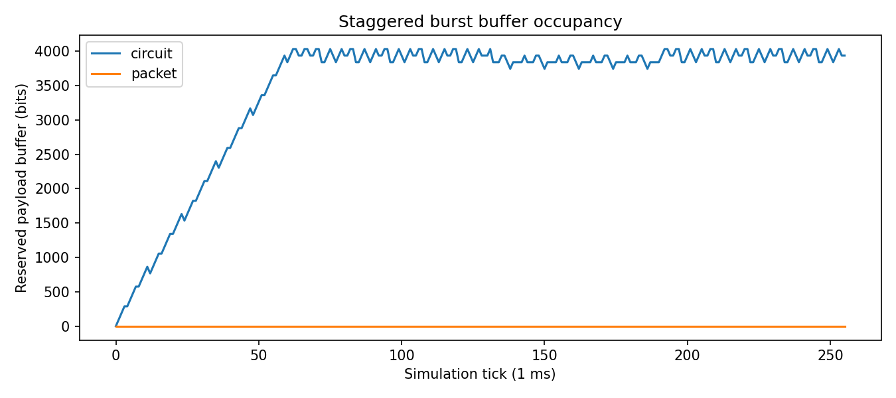
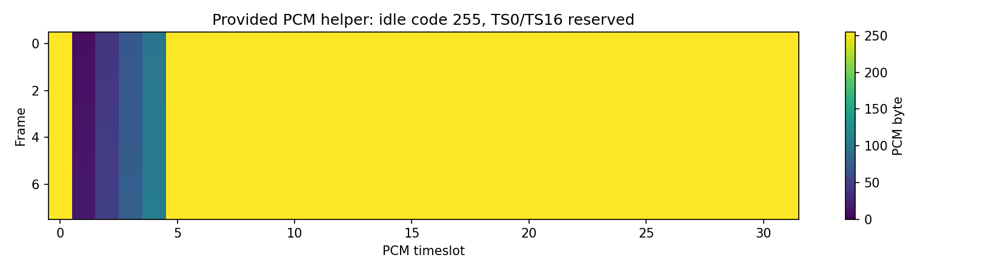

# 实验一报告

姓名：陈泓帆  学号：2023280241  GitHub：lio-Granna  提交编号：01

## 实验目的
本实验通过 Python 仿真对比固定时隙电路交换与共享 FIFO 分组交换在相同链路条件下的资源使用差异。重点观察统计复用收益与包头开销之间的权衡：电路交换严格按用户划分时隙、无包头开销但空闲时隙不可借用；分组交换通过共享队列获得灵活性，但每条记录需附加 32 bit 包头。

## 原理和模型
- **固定预留（电路交换）**：每个用户固定占有 `tick % users` 时隙，其他用户不得借用。无包头开销，发送预算直接等于 payload_bits。
- **统计复用（分组交换）**：所有用户共享一条 FIFO 队列，任一时隙可服务任意用户。每条记录准入时初始化 32 bit 包头（`remaining_wire_bits = payload_bits + header_bits`），后续不再重复加头。
- **缓存准入**：两模型均以 payload 总和计量缓存（4096 bit），包含在传记录。到达时若预留超限则整条尾丢弃；完整交付后才释放空间。
- **有限观察窗口**：256 tick，窗口结束立即停止不排空，未完成记录计为积压。
- **抽象链路**：128 kbit/s（每 tick 128 bit），不同于 PCM 示例的 32 时隙 × 8 bit × 8000 帧/s = 2.048 Mbit/s。

## 手工推演
设 2 用户、2 tick、每 tick 1 ms、容量 128 bit、包头 32 bit、缓存足够。仅 tick 0 用户 1 到达一条 96 bit 记录。

| | 电路交换 | 分组交换 |
|---|---|---|
| tick 0 服务 | 用户 0（空，闲置） | 用户 1 记录 wire=128，发送 128 bit，完成 |
| tick 1 服务 | 用户 1，发送 96 bit，完成 | 空闲 |
| 有效利用率 | 96/256 = 37.5% | 96/256 = 37.5% |
| 线路忙碌率 | 96/256 = 37.5% | 128/256 = 50% |
| 完成时延 | 2 ms | 1 ms |

结论：**相同有效利用率不代表相同时延**。电路因固定时隙闲置了 tick 0，分组因包头多用了 32 bit 线路容量但更早完成。

## 实验结果

四种业务场景的指标对比：

| 场景 | 模型 | 有效利用率 | 线路利用率 | 平均时延(ms) | 最大时延(ms) | 丢失率 | 积压(bit) |
|---|---|---|---|---|---|---|---|
| continuous | circuit | 1.0 | 1.0 | 2.5 | 4.0 | 0 | 0 |
| continuous | packet | 0.797 | 1.0 | 26.15 | 40.0 | 0.090 | 3712 |
| staggered_burst | circuit | 0.492 | 0.495 | 45.10 | 127.0 | 0.184 | 3936 |
| staggered_burst | packet | 0.750 | 1.0 | 1.0 | 1.0 | 0 | 0 |
| synchronized_burst | circuit | 0.340 | 0.344 | 12.71 | 24.0 | 0 | 1152 |
| synchronized_burst | packet | 0.328 | 0.438 | 15.36 | 32.0 | 0 | 1536 |
| light_random | circuit | 0.211 | 0.211 | 3.11 | 10.0 | 0 | 0 |
| light_random | packet | 0.211 | 0.281 | 1.10 | 2.0 | 0 | 0 |

**利用率和时延指向不同结论的案例**：`staggered_burst` 场景中，电路交换有效利用率仅 0.492、丢失率 0.184、平均时延 45 ms；而分组交换有效利用率 0.750、零丢失、平均时延仅 1 ms。这是因为电路交换固定每 4 tick 轮询一次各用户，而突发业务集中在单个活跃用户时，其他三个用户的时隙全部浪费。分组交换则让唯一活跃用户独占全部带宽，统计复用在此类热点场景下优势显著。

`continuous` 场景中电路交换有效利用率（1.0）反而高于分组（0.797），因为电路无包头开销；分组每条 128 bit 记录加 32 bit 包头后 160 wire_bits > 128 slot_bits，需跨 tick 发送，导积压不断累积、时延升高甚至丢包。

## 自拟反例
`student_tests/test_my_case.py` 测试"分组交换重复添加包头"错误——若实现误在每次发送时重新加 header_bits，会导致 wire 计数膨胀、预算被超额消耗。

输入：2 用户、一条 96 bit 记录、verified_wire = 128（payload + header 各一次）。断言一个 tick 内 wire 发送 ≤ slot_bits 且记录正确完成。

## 分析与限制
- **统计复用何时有优势**：业务不均匀、存在突发热点时（如 `staggered_burst`），共享 FIFO 可让活跃用户充分利用空闲带宽，避免固定预留的闲置。
- **满载连续场景为何分组未必更好**：所有用户持续等量发送时，无空闲时隙可借用，包头成为纯开销（每 128 bit payload 多 32 bit），导致有效利用率下降、积压累积。
- **未完成数据不能当成丢包**：积压是窗口截断导致的在途记录，后续 tick 本可完成；丢失是缓存准入时因空间不足主动丢弃。两者在守恒式中分量不同。
- **不能只看成功记录的平均时延**：如果大量记录积压或丢弃，少量快速完成记录的时延可以很低，但整体服务质量差。必须同时检查丢失率和积压。

## 参考文献
- 课堂课件及 PRD 文档（V1.2, 2026-10-18）
- 教师仓库：https://github.com/jwentong/modern-switching-experiment-01
- `docs/model_contract.md` 模型合同
- `examples/teacher_results/` 教师参考结果